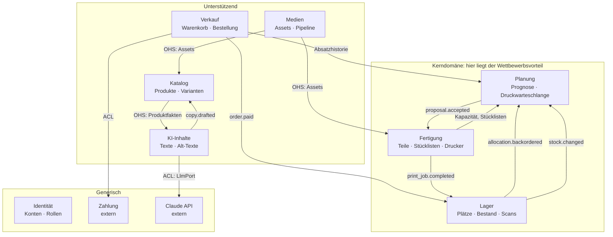
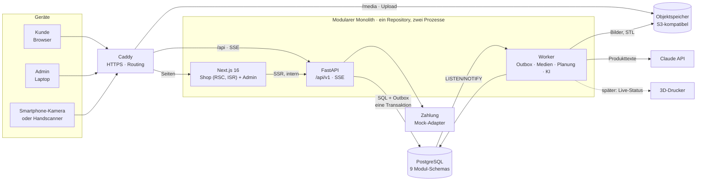
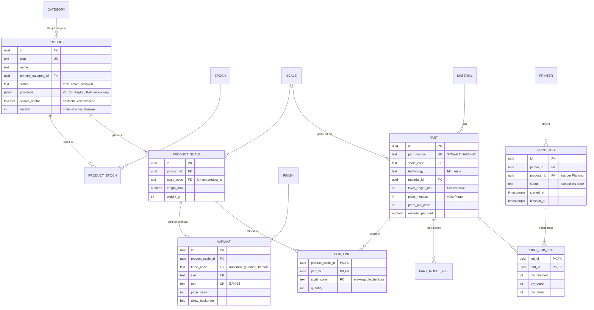
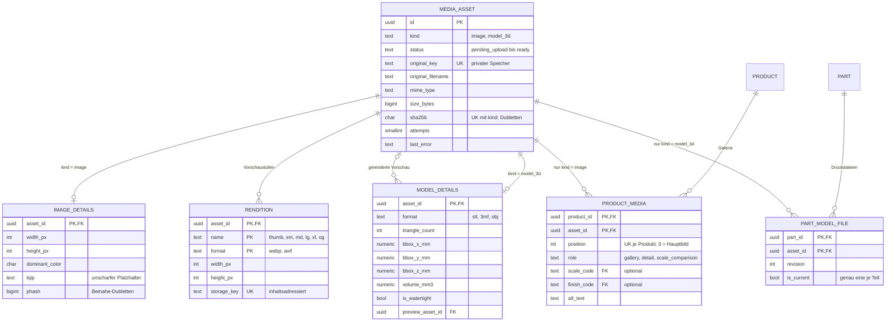
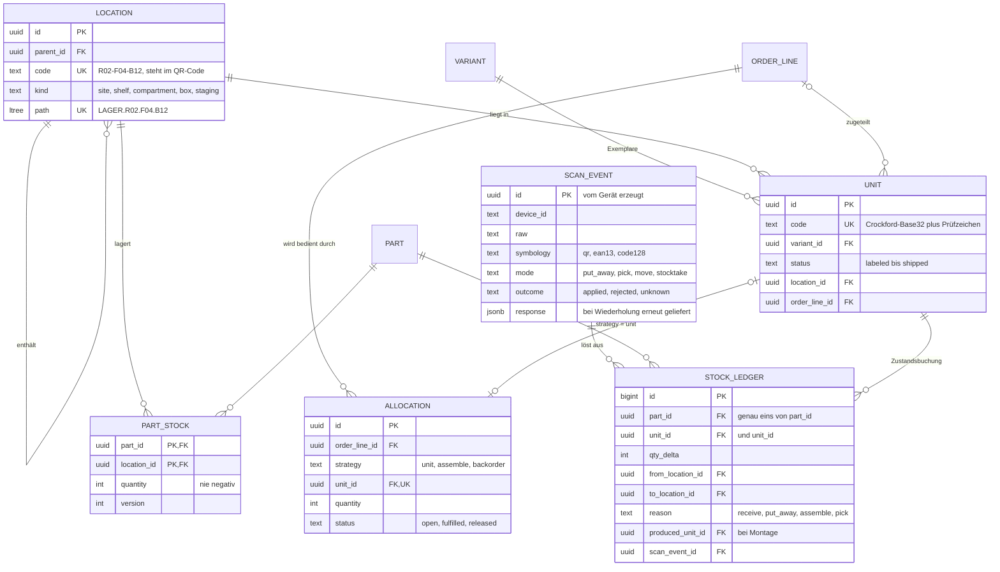
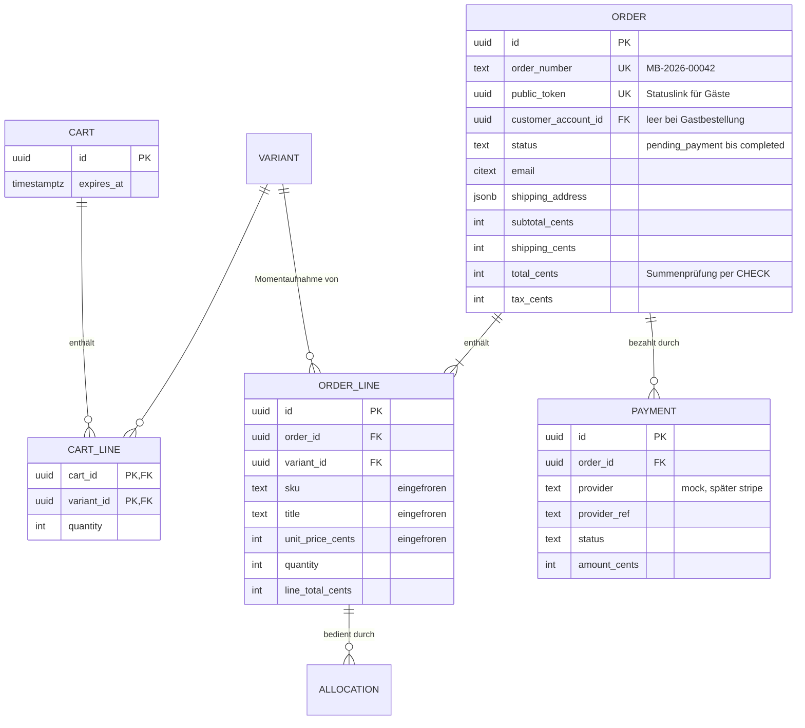
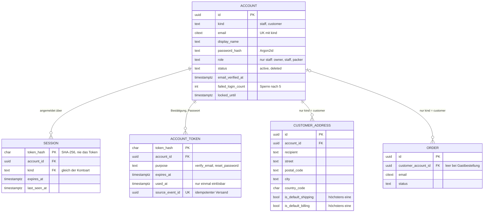
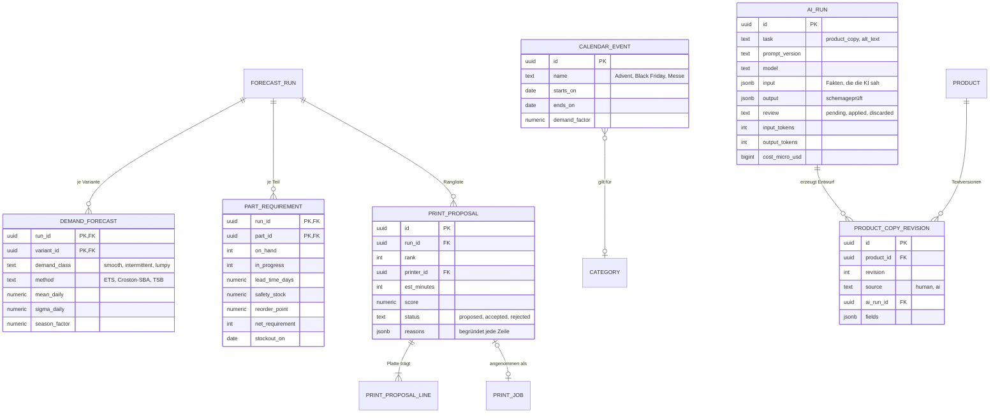

# Modellbahn-Shop · Architekturkonzept

> **Stand:** Schritt 1 freigegeben am 21.10.2026 · Schritt 2 (Fundament) in Arbeit
> **Umfang:** Domänenmodell (DDD), Systemarchitektur, Tech-Stack, Datenmodell (ERD),
> Medien-Pipeline, Barcode-Engine, KI-Schnittstellen, API-Architektur, Fahrplan
> **Geprüft:** Das Datenmodell wurde gegen PostgreSQL 17 geprüft
> (siehe [5.8](#58-was-die-datenbank-erzwingt-und-wie-das-geprüft-wurde)).

---

## 0 · Auf einen Blick

Ein Webshop und ein Werkstatt-Backend für 3D-gedruckte Modellbahn-Artikel, gebaut
als **modularer Monolith** mit neun fachlichen Modulen. Jedes Modul ist intern nach
**Clean Architecture** geschnitten, besitzt sein eigenes Datenbankschema und spricht
mit den anderen nur über veröffentlichte Verträge und Domänenereignisse. Damit lässt
sich jedes Modul später als eigener Dienst herauslösen, ohne dass die anderen es
merken.

| Kennzahl | Wert |
| --- | --- |
| Fachliche Module (Bounded Contexts) | 9 |
| Tabellen im Datenmodell | 46, verteilt auf 9 Schemas |
| Integritätsregeln in der Datenbank (CHECK, FK, UNIQUE) | 203 |
| Prüfungen gegen echtes PostgreSQL | 38 von 38 bestanden (35 Gegentests, 3 Positivtests) |
| API-Endpunkte im Entwurf | 99, dazu 3 für den Betrieb |

Die drei Entscheidungen, die alles Weitere prägen:

1. **Ein Bausatz ist eine Stückliste, kein Artikel.** Gedruckt werden *Teile*,
   verkauft werden *Varianten*. Dazwischen liegt die Stückliste. Erst dadurch
   kann die Druckplanung rechnen, und das Lager weiß, welche Teile in welcher Box liegen.
2. **Kleinteile werden gezählt, fertige Ware wird einzeln geführt.** Ein Schornstein
   in H0 trägt kein Etikett, die Box trägt es. Ein fertiger Bausatz bekommt dagegen
   einen eigenen QR-Code und ist über seinen ganzen Lebenslauf rückverfolgbar.
3. **Die KI rechnet nicht, sie formuliert.** Prognose und Druckwarteschlange sind
   Mathematik (Croston, ETS, Sicherheitsbestand, Plattenbildung), lokal und
   nachvollziehbar. Das Sprachmodell schreibt Verkaufstexte aus geprüften Fakten.
   Jeder KI-Vorschlag geht als Entwurf an einen Menschen.

---

## 1 · Leitlinien

| Leitlinie | Was sie konkret bedeutet |
| --- | --- |
| **Fachlichkeit vor Technik** | Module schneiden entlang der Werkstatt (Lager, Fertigung, Planung), nicht entlang von Schichten. |
| **Die Datenbank ist die letzte Verteidigungslinie** | Invarianten, die ein Bug verletzen könnte, stehen zusätzlich als Constraint im Schema. |
| **Nichts Abgeleitetes speichern** | Bestand, „Drucker druckt gerade“, Hauptbild: Das wird abgeleitet. Ein zweites Feld könnte dem ersten widersprechen. |
| **Geschäftsvorfälle sind unveränderlich** | Bestellungen, Zahlungen und Lagerbuchungen werden nie gelöscht, nur durch Gegenbuchungen korrigiert. |
| **Jede Aktion ist wiederholbar** | Scans, Zahlungen und Uploads tragen eine Kennung vom Client. Eine Wiederholung nach einem Netzabbruch bucht nicht doppelt. |
| **Asynchron, wo es dauert** | Bildverarbeitung, KI und Prognose laufen im Worker. Die Oberfläche bekommt das Ergebnis per Server-Sent Events. |
| **Mensch im Regelkreis** | Weder ein KI-Text noch ein Druckvorschlag wird ohne Bestätigung wirksam. |
| **Ein Schema, drei Verwendungen** | Ein Pydantic-Modell validiert die Anfrage, erzeugt den OpenAPI-Vertrag und begrenzt die Ausgabe des Sprachmodells. |

---

## 2 · Die Domäne

### 2.1 Subdomänen

| Art | Subdomäne | Warum diese Einordnung |
| --- | --- | --- |
| **Kern** | Planung | Was wann auf welchen Drucker kommt, entscheidet über Lieferfähigkeit und gebundenes Kapital. Kein Standardprodukt kann das für 3D-Druck auf Bestellung. |
| **Kern** | Fertigung | Teile, Stücklisten, Druckplatten, Nachbearbeitung: das eigentliche Handwerk. |
| **Kern** | Lager | Teilebestand in Boxen, Montage zu Bausätzen, Einzelverfolgung fertiger Ware. |
| Unterstützend | Katalog | Fachlich anspruchsvoll (Spurweiten, Epochen, Ausführungen), aber kein Alleinstellungsmerkmal. |
| Unterstützend | Verkauf | Warenkorb, Checkout, Bestellstatus: notwendig, aber gut verstanden. |
| Unterstützend | Medien | Fotos und 3D-Dateien mit eigener Verarbeitungsstrecke. |
| Unterstützend | KI-Inhalte | Verkaufstexte und Alt-Texte aus Produktfakten. |
| Generisch | Identität | Konten für Mitarbeiter und Kunden, Sitzungen, Rollen. Bewährte Verfahren, sorgfältig umgesetzt. |
| Generisch | Zahlung | Angebunden über eine Schutzschicht, zunächst als Mock. |

### 2.2 Bounded Contexts

| Modul | Schema | Verantwortung | Aggregate (Wurzel fett) |
| --- | --- | --- | --- |
| Identität | `identity` | Anmeldung für Mitarbeiter (Rollen `owner`, `staff`, `packer`) und Kunden, Sitzungen getrennt nach Bereich, E-Mail-Bestätigung, Passwort zurücksetzen | **Account**, Session, AccountToken |
| Katalog | `catalog` | Was verkauft wird und wie es heißt | **Product** (mit ProductScale, Variant), **Category** |
| Medien | `media` | Speichern, prüfen, umwandeln, ausliefern | **MediaAsset** (mit Details, Renditions) |
| Fertigung | `manufacturing` | Was gedruckt wird und woraus ein Bausatz besteht | **Part**, **BillOfMaterials**, **Printer**, **PrintJob** |
| Lager | `inventory` | Wo was liegt, und jede Bewegung dazu | **Location**, **PartStock**, **Unit**, **Allocation** |
| Verkauf | `sales` | Warenkorb, Bestellung, Zahlung, Adressbuch der Kunden | **Cart**, **Order**, **Payment**, **CustomerAddress** |
| Planung | `planning` | Prognose und Druckwarteschlange | **ForecastRun**, **PrintProposal** |
| KI-Inhalte | `ai` | Textentwürfe, Protokoll jedes Modellaufrufs | **AiRun** |
| Plattform | `platform` | Outbox, Idempotenz (kein Fachmodul) | – |

### 2.3 Ubiquitäre Sprache

Fachbegriffe sind Deutsch, Bezeichner im Code Englisch. Diese Tabelle ist die Brücke
und gilt für Gespräche, Tickets, Oberfläche und Code gleichermaßen.

| Begriff | Im Code | Bedeutung |
| --- | --- | --- |
| Produkt | `Product` | Ein Modell als Idee, z. B. „Stellwerk Altenau“ |
| Spurweite / Baugröße | `Scale` | H0 (1:87, 16,5 mm), TT (1:120, 12 mm), N (1:160, 9 mm) |
| Produkt in Spurweite | `ProductScale` | Das Modell in einer Baugröße, mit eigenen Maßen und eigener Stückliste |
| Ausführung | `Finish` | Unbemalt, grundiert, fertig bemalt |
| Variante | `Variant` | Was im Warenkorb liegt: Produkt × Spurweite × Ausführung, mit SKU, EAN und Preis |
| Epoche | `Epoch` | Zeitabschnitt der Eisenbahngeschichte, I bis VI |
| Teil | `Part` | Ein druckbares Einzelteil, z. B. „Dach Stellwerk Altenau H0“ |
| Stückliste | `BillOfMaterials` | Welche Teile in welcher Menge einen Bausatz bilden |
| Druckplatte, Druckauftrag | `PrintJob` | Ein Druckvorgang; eine Platte trägt oft mehrere Teile |
| Lagerplatz | `Location` | Lager → Regal → Fach → Box, jede Ebene mit eigenem QR-Code |
| Einheit, Exemplar | `Unit` | Ein physisches, fertiges Stück mit eigenem Code |
| Montage | `Assembly` | Teile aus Boxen entnehmen und zu einer Einheit zusammenstellen |
| Zuteilung | `Allocation` | Welche Ware eine Bestellposition bedient: Einheit, Montage oder Rückstand |
| Einlagern, Kommissionieren, Umlagern | `put_away`, `pick`, `move` | Die Scan-Modi im Lager |
| Meldebestand | `reorder_point` | Unter dieser Menge wird nachgedruckt |
| Durchlaufzeit | `lead_time` | Warteschlange + Druck + Nachbearbeitung + Montage |
| Kundenkonto | `Account` mit `kind = customer` | Registrierter Kunde mit bestätigter E-Mail-Adresse, Adressbuch und Bestellhistorie |
| Mitarbeiterkonto | `Account` mit `kind = staff` | Zugang zum Admin-Bereich mit der Rolle `owner`, `staff` oder `packer` |
| Gastbestellung | `Order` ohne Konto | Bestellung nur mit E-Mail-Adresse; wird übernommen, sobald ein Konto mit derselben bestätigten Adresse existiert |

### 2.4 Aggregate und ihre Invarianten

| Aggregat | Invarianten, die das Aggregat selbst schützt |
| --- | --- |
| **Product** | Jede Kombination Spurweite × Ausführung höchstens einmal. Aktiv nur mit mindestens einer aktiven Variante und einem Bild. Preise ≥ 0, Streichpreis > Preis. |
| **BillOfMaterials** | Nur Teile derselben Spurweite. Mengen > 0. Ändert sich die Stückliste, entsteht eine neue Fassung; bestehende Einheiten behalten ihre. |
| **PrintJob** | Zustandsfolge `queued → printing → post_processing → done` (oder `failed`, `cancelled`). Gute + fehlerhafte Teile ≤ geplante. Pro Drucker läuft höchstens ein Druck. |
| **Location** | Baum ohne Zyklen. Nur Boxen und Fächer nehmen Ware auf. Der Code ist eindeutig und unveränderlich, denn er klebt als Etikett am Regal. |
| **PartStock** | Menge je Teil und Platz nie negativ. Änderungen nur zusammen mit einer Journalbuchung. |
| **Unit** | Lebenslauf `labeled → in_stock → allocated → picked → shipped`, dazu `returned`, `scrapped`. Im Lager nur mit Platz; zugeteilt nur mit Bestellposition. |
| **Order** | Summe = Zwischensumme + Versand − Rabatt. Positionen frieren Preis, Titel und SKU ein. Nach Zahlung keine Positionsänderung. |
| **Account** | E-Mail-Adresse je Kontoart eindeutig, ohne Groß- und Kleinschreibung. Eine Rolle genau dann, wenn Mitarbeiter. Sitzungen nur für die eigene Kontoart. Nach 5 Fehlversuchen gesperrt, mit wachsender Dauer. Löschen heißt anonymisieren; die Zeile bleibt, weil Bestellungen auf sie verweisen. |
| **PrintProposal** | Angenommen oder abgelehnt nur mit Zeitpunkt und Person. Ein Vorschlag erzeugt höchstens einen Druckauftrag. |

### 2.5 Domänenereignisse

Ereignisse entstehen im Aggregat und werden **in derselben Transaktion** in die
Outbox geschrieben wie die Zustandsänderung. Es gibt also kein „gespeichert, aber
Ereignis verloren“.

| Ereignis | Erzeugt von | Wer reagiert |
| --- | --- | --- |
| `identity.customer.registered` | Identität | Worker: Bestätigungsmail; Admin-Liveansicht |
| `identity.account.email_verified` | Identität | Verkauf: Gastbestellungen mit dieser Adresse übernehmen |
| `identity.account.deleted` | Identität | Verkauf: Adressen löschen; personenbezogene Daten nach Ablauf der Aufbewahrungsfristen anonymisieren |
| `catalog.product.published`, `.updated` | Katalog | Shop-Cache (Revalidierung), Planung |
| `media.asset.uploaded` | Medien | Worker: Verarbeitung starten |
| `media.asset.ready`, `.failed` | Medien | Admin-Oberfläche per SSE |
| `sales.order.paid` | Verkauf | Lager: zuteilen |
| `sales.order.cancelled` | Verkauf | Lager: Zuteilung freigeben |
| `inventory.allocation.backordered` | Lager | Planung: Rückstand einplanen |
| `inventory.stock.changed` | Lager | Planung, Dashboard per SSE |
| `inventory.stock.below_reorder_point` | Lager | Planung: außerplanmäßig neu rechnen |
| `manufacturing.print_job.completed` | Fertigung | Lager: Teile im Wareneingang buchen |
| `planning.proposal.accepted` | Planung | Fertigung: Druckauftrag anlegen |
| `ai.copy.drafted` | KI-Inhalte | Admin-Oberfläche per SSE |

### 2.6 Context Map



| Beziehung | Muster | Begründung |
| --- | --- | --- |
| Verkauf → Lager | Customer/Supplier, asynchron | Die Bestellung wartet nicht auf das Lager; eine bezahlte Bestellung ist gültig, auch wenn noch gedruckt werden muss. |
| Lager, Verkauf, Fertigung → Planung | Published Language | Planung liest nur und schreibt nirgends hinein. Damit ist sie der ideale erste Kandidat für einen eigenen Dienst. |
| Planung → Fertigung | Customer/Supplier | Ein Vorschlag wird erst durch Annahme zum Auftrag. |
| Medien → Katalog, Fertigung | Open Host Service | Medien kennt weder Produkte noch Teile, nur Assets. |
| Verkauf → Zahlungsanbieter | Anti-Corruption Layer | Das Modell des Anbieters dringt nicht ins eigene ein; der Mock ist ein gleichwertiger Adapter. |
| KI-Inhalte → Claude API | Anti-Corruption Layer (`LlmPort`) | Modell und Anbieter sind austauschbar, Kosten werden zentral erfasst. |

---

## 3 · Systemarchitektur

### 3.1 Modularer Monolith



Ein Repository, zwei Prozesse aus derselben Codebasis: **API** (zustandslos, beliebig
oft startbar) und **Worker** (verarbeitet Outbox und Hintergrundjobs). PostgreSQL ist
anfangs auch die Warteschlange: Jobs werden mit `SELECT … FOR UPDATE SKIP LOCKED`
verteilt, `LISTEN/NOTIFY` weckt die Worker ohne Polling. Ein Nachrichtenbroker kommt
erst, wenn ein Modul tatsächlich ausgelagert wird.

### 3.2 Clean Architecture im Modul

```
backend/src/modellbahn/
├── platform/                  gemeinsamer Kern: Geld, IDs, Outbox, Unit of Work, Fehler
└── modules/
    └── inventory/
        ├── domain/            Entitäten, Wertobjekte, Ereignisse, Domänendienste
        │                      reines Python, kein Framework, keine Datenbank
        ├── application/       Anwendungsfälle (Commands, Queries), Ports (Schnittstellen)
        ├── infrastructure/    SQLAlchemy-Repositories, Adapter für Speicher, Drucker, LLM
        ├── api/               FastAPI-Router, Anfrage- und Antwortmodelle
        └── contracts/         das Einzige, was andere Module importieren dürfen:
            ├── events.py      Ereignisse und ihre Typen, frameworkfrei
            └── <fassade>.py   Abfragen für fremde Anwendungsfälle (mit SQL)
```

**Abhängigkeitsregel:** `api → application → domain` und `infrastructure → application`.
Die Domäne hängt von nichts ab. Pflicht ist nur `domain`: Ein Modul ohne eigene
Oberfläche oder Tabellen lässt die übrigen Schichten weg. Fremde Module sieht ein Modul
nur über deren `contracts`. Eine fremde Domäne darf auf die Ereignisse reagieren, die
Fassaden aber nur Anwendungsfälle und Infrastruktur nutzen, weil sie SQL ausführen. Das
ist keine Konvention auf Papier: **import-linter** prüft es in jedem CI-Lauf, und ein
verbotener Import bricht den Build.

Die Domänenobjekte sind einfache Dataclasses. SQLAlchemy bildet sie über *imperatives
Mapping* auf Tabellen ab, ohne dass die Domäne von einer ORM-Basisklasse erbt. So
lässt sich die Domäne ohne Datenbank in Millisekunden testen.

### 3.3 Kommunikation zwischen Modulen

| Bedarf | Weg | Beispiel |
| --- | --- | --- |
| Synchrone Abfrage | Fassade aus `contracts` | Verkauf fragt Katalog nach Preis und Verfügbarkeit |
| Reaktion auf Geschehenes | Domänenereignis über die Outbox | `sales.order.paid` → Lager teilt zu |
| Lange Arbeit | Job über die Outbox | Bild umwandeln, Prognose rechnen |

### 3.4 Echtzeit ohne Neuladen

Die Outbox meldet sich per `NOTIFY`. Jede API-Instanz hält einen `LISTEN`-Kanal und
reicht passende Ereignisse als **Server-Sent Events** an verbundene Admin-Oberflächen
weiter. Die Oberfläche aktualisiert ihre Query-Caches gezielt. Ein Scan am Handy
verändert so binnen Millisekunden die Bestandszahl auf dem Dashboard am Laptop.
SSE statt WebSocket, weil der Datenfluss nur eine Richtung braucht, durch jeden Proxy
geht und mit `Last-Event-ID` nach einem Verbindungsabbruch lückenlos weitermacht.

### 3.5 Skalierung und der Weg zu Microservices

| Engpass | Maßnahme | Wann |
| --- | --- | --- |
| Shop-Seiten | Statisch gerendert (ISR), ausgeliefert per CDN, Revalidierung per Ereignis | ab Start |
| Bilder | Vorgerenderte Stufen mit inhaltsadressierten Namen, `Cache-Control: immutable` | ab Start |
| API | Zustandslos, horizontal skalierbar hinter Caddy | bei Bedarf |
| Worker | Beliebig viele Instanzen dank `SKIP LOCKED` | bei Bedarf |
| Datenbank | Lesereplikate; Lagerjournal und Outbox monatlich partitionieren | ab ca. 10 Mio. Zeilen |

Weil jedes Modul ein eigenes Schema besitzt, ist das Herauslösen ein geplanter
Handgriff: Schema in eine eigene Datenbank verschieben, Fremdschlüssel über die
Grenze durch ID plus lokale Lesekopie ersetzen, Outbox-Transport von PostgreSQL auf
NATS JetStream umstellen. Reihenfolge nach Nutzen: **Medien** (CPU-lastig),
**Planung** (eigener ML-Stack, rechnet nächtlich), **KI-Inhalte**. Katalog, Lager und
Verkauf bleiben zusammen, solange kein Grund dagegen spricht.

---

## 4 · Tech-Stack

### Backend

| Baustein | Wahl | Warum |
| --- | --- | --- |
| Sprache | **Python 3.13** | Das stärkste Ökosystem für KI und Numerik (statsforecast, NumPy, trimesh, Pillow, Anthropic SDK). Eine Sprache für API, Bildverarbeitung, Prognose und LLM. |
| Web-Framework | **FastAPI** | Asynchron: Hunderte gleichzeitige Uploads, LLM-Aufrufe und SSE-Verbindungen ohne Thread pro Anfrage. Erzeugt OpenAPI 3.1 aus dem Code. |
| Validierung | **Pydantic v2** | Kern in Rust und damit schnell. Dasselbe Modell validiert Anfragen und beschreibt die strukturierte Ausgabe des Sprachmodells. |
| Datenzugriff | **SQLAlchemy 2.0** (async, asyncpg) + **Alembic** | Typisiert, imperatives Mapping für eine saubere Domäne, versionierte Migrationen. |
| Architekturprüfung | **import-linter** | Macht die Modulgrenzen zu einer Regel, die der Build prüft. |
| Werkzeuge | **uv**, **Ruff**, **mypy** (strict), **pytest** + **Testcontainers** | Schnelle Installation, ein Linter, strenge Typen, Tests gegen echtes PostgreSQL statt SQLite. |

### Daten und Speicher

| Baustein | Wahl | Warum |
| --- | --- | --- |
| Datenbank | **PostgreSQL 17** (mindestens 15) | Schemas je Modul, `ltree` für Lagerbäume, `citext`, deutsche Volltextsuche, `SKIP LOCKED` als Warteschlange, später `pgvector` für semantische Suche. |
| Objektspeicher | **S3-kompatibel** (z. B. Hetzner Object Storage oder Cloudflare R2; lokal Garage) | Direkter Upload per signierter URL: Große STL-Dateien gehen nicht durch die API. Lokal reicht ein Dateisystem-Adapter hinter demselben Port. |

### Medien, Barcodes, Prognose, KI

| Baustein | Wahl | Warum |
| --- | --- | --- |
| Bilder | **Pillow** + **pillow-heif** | WebP und AVIF; HEIC, weil Handyfotos vom iPhone so ankommen. |
| 3D-Dateien | **trimesh** | Liest STL, 3MF und OBJ: Dreiecke, Maße, Volumen, Wasserdichtheit. |
| Dubletten | **imagehash** | Wahrnehmungs-Hash erkennt dasselbe Foto auch nach erneutem Export. |
| Barcodes | **segno** (QR), **python-barcode** (EAN-13, Code 128) | Reine Python-Bibliotheken, SVG-Ausgabe für gestochen scharfe Etiketten. |
| Etiketten | **reportlab** (PDF) bzw. **brother_ql** | PDF für Bogenetiketten oder direkt an einen Etikettendrucker im Netz. |
| Prognose | **statsforecast** (Nixtla) | ETS, Croston-SBA, TSB, ADIDA: genau die Verfahren für sporadische Nachfrage, lokal und schnell. |
| Optimierung | eigene Heuristik, später **OR-Tools CP-SAT** | Plattenbildung und Druckerzuteilung erst nachvollziehbar, dann optimal. |
| Sprachmodell | **Claude Opus 5.5** (`claude-opus-5-5`) über das **Anthropic Python SDK** | Strukturierte Ausgaben gegen ein Pydantic-Schema, Prompt-Caching für den festen Teil, Batch-API zum halben Preis für Massenläufe. |

### Frontend

| Baustein | Wahl | Warum |
| --- | --- | --- |
| Framework | **Next.js 16** (App Router) + **React 19** + **TypeScript** (strict) | Server Components: Shop-Seiten statisch und SEO-stark; der Admin-Bereich als reaktive Client-App im selben Projekt. |
| Gestaltung | **Tailwind CSS v4** + **shadcn/ui** (Radix) | Eigenes Designsystem ohne Template-Optik, barrierearm durch Radix. |
| Serverzustand | **TanStack Query v5** | Optimistische Updates beim Scannen, gezielte Invalidierung per SSE. |
| API-Client | **Orval** aus OpenAPI | Typisierte Hooks und Zod-Schemas, erzeugt aus dem Backend-Vertrag. |
| Scan-Sitzung | **XState v5** | Der Scanablauf ist ein Zustandsautomat; XState macht ihn explizit, testbar und darstellbar. |
| Globaler UI-Zustand | **Zustand** | Klein und ohne Boilerplate, z. B. für den Scan-Bus. |
| Kamera-Scan | **html5-qrcode**, nativer **BarcodeDetector**, wo vorhanden | Wie gewünscht, mit schnellerem Weg auf Android-Chrome. |
| Galerie | **Embla Carousel** | Wischgesten, leicht, ohne Fremdgestaltung. |
| Diagramme | **Recharts** | Dashboard und Prognosekurven. |

### Betrieb

| Baustein | Wahl | Warum |
| --- | --- | --- |
| Laufzeit | **Docker Compose** | Ein Befehl für Datenbank, API, Worker, Frontend, Proxy. |
| Proxy | **Caddy** | Automatisches HTTPS. Die Kamera im Browser verlangt einen sicheren Kontext, auch im Lager-WLAN. |
| CI | **GitHub Actions** | Lint, Typen, Tests, Architekturregeln, OpenAPI-Abgleich. |
| Beobachtbarkeit | **structlog** + **OpenTelemetry** | Strukturierte Logs, Traces über API, Worker und LLM-Aufrufe. |

---

## 5 · Datenmodell

### 5.1 Konventionen

- **IDs sind UUIDv7**, im Code erzeugt: zeitlich sortierbar, ohne Datenbank-Sequenz
  und damit über Dienstgrenzen hinweg eindeutig. Lesbare Nummern (Bestellnummer,
  SKU, Teilenummer, Einheitencode) kommen zusätzlich.
- **Geld in Cent** als Ganzzahl, Preise brutto, Steuersatz in Basispunkten.
- **Zustände als Text mit CHECK** statt ENUM-Typ: Ein neuer Zustand ist dann eine
  Zeile Migration.
- **Dateien liegen nie in der Datenbank.** Gespeichert wird der Speicherschlüssel;
  die URL entsteht zur Laufzeit.
- **Fremdschlüssel über Modulgrenzen** zeigen nur auf Aggregatwurzeln oder
  Referenzdaten und löschen nie kaskadierend (`RESTRICT` oder `SET NULL`). Beim
  Herauslösen eines Moduls werden genau diese Kanten zu ID plus Ereignis.

### 5.2 Katalog und Fertigung: die Bausatz-Logik



**So hängt ein Bausatz zusammen:** Das *Produkt* „Stellwerk Altenau“ gibt es *in
Spurweite* H0 und N. „Stellwerk Altenau H0“ hat eine *Stückliste*: 1 × Gebäudekörper,
1 × Dach, 2 × Schornstein, 1 × Fensterset. Verkauft wird es als drei *Varianten*,
unbemalt, grundiert und fertig bemalt. Alle drei teilen sich die Stückliste, denn
bemalt wird nach dem Druck.

Die Stückliste trägt die Spurweite ein zweites Mal, und zwei zusammengesetzte
Fremdschlüssel prüfen sie gegen das Produkt *und* gegen das Teil. Ein N-Dach kann
deshalb nicht in einen H0-Bausatz geraten, auch nicht durch einen Fehler im Code.

Die Druckdaten hängen am **Teil**, nicht an der Variante: Schichtdicke, Minuten je
volle Platte, Teile je Platte, Materialverbrauch. Beim Resindruck bestimmt die Höhe
die Druckzeit, nicht die Stückzahl. Eine volle Platte kostet kaum mehr Zeit als ein
einzelnes Teil, und genau das nutzt die Planung.

### 5.3 Medien: eine zentrale Tabelle mit Spezialisierungen



Alle Dateien stehen in **einer** Tabelle `media.assets`, ob Produktfoto, gerendertes
Vorschaubild oder STL-Datei. Was nur für eine Art gilt, steht in einer eigenen
Tabelle mit dem Asset als Primärschlüssel (*Class Table Inheritance*):
`image_details` für Bilder, `model_details` für 3D-Modelle, `renditions` für die
erzeugten Vorschaustufen. Eine breite Tabelle mit vielen leeren Spalten entfällt.

**Die Art wird durch Fremdschlüssel erzwungen, nicht durch Disziplin.** Jede
verweisende Tabelle trägt die erwartete Art als festen Wert und verweist auf das Paar
`(id, kind)`. Eine STL-Datei lässt sich so nicht als Produktfoto einhängen, und ein
Foto nicht als Druckdatei. Beides ist getestet.

| Frage | Antwort im Modell |
| --- | --- |
| Welches ist das Hauptbild? | Das mit `position = 0`. Kein zweites Feld, das widersprechen könnte. |
| Zeigt das Foto die bemalte Ausführung? | `finish_code` und `scale_code` an der Galerieverknüpfung. Die Galerie wechselt mit der Auswahl im Shop. |
| Wie wird umsortiert? | Die Eindeutigkeit der Position wird erst am Transaktionsende geprüft; Tauschen geht in einem Schritt. |
| Wurde dasselbe Foto zweimal hochgeladen? | Eindeutig je `(kind, sha256)`; der Browser rechnet den Hash schon vor dem Upload. |
| Woher kommt das Vorschaubild einer STL? | Der Worker rendert es als eigenes Bild-Asset, `model_details.preview_asset_id` verweist darauf. |
| Welche STL ist die aktuelle? | Revisionen je Teil; genau eine ist `is_current`, per Teilindex erzwungen. |

**Speicherpfade:**

```
privat/                                      nie öffentlich, nur über signierte Kurzzeit-URL
└── incoming/0192f6c3-…/original.heic        Original, unverändert
└── incoming/0192f6d0-…/original.stl

öffentlich/                                  per CDN, Cache-Control: immutable
└── 0192f6c3-…/thumb-1a2b3c4d.webp           256 × 256, quadratisch
└── 0192f6c3-…/md-1a2b3c4d.webp              960 px breit
└── 0192f6c3-…/md-1a2b3c4d.avif
└── 0192f6c3-…/xl-1a2b3c4d.webp              2400 px breit, nur wenn das Original so groß ist
```

Der Hash im Dateinamen macht jede Stufe unveränderlich. Ein neu verarbeitetes Bild
bekommt einen neuen Namen, und kein Cache liefert je eine veraltete Fassung aus.

### 5.4 Lager und Barcodes



**Zwei Arten von Bestand, bewusst getrennt:**

| | Teilebestand | Einheiten |
| --- | --- | --- |
| Was | Gedruckte Einzelteile | Fertige Bausätze und Modelle |
| Geführt als | Menge je Teil und Platz | Jedes Stück einzeln |
| Etikett | An der Box, nicht am Teil | Am Stück, mit eigenem QR-Code |
| Entsteht durch | Abschluss eines Druckauftrags | Montage aus Teilen |

**Lagerplätze** bilden einen Baum mit `ltree`-Pfad, etwa `LAGER.R02.F04.B12` für
Regal 2, Fach 4, Box 12. „Alles in Regal 2“ ist eine einzige indizierte Abfrage
(`path <@ 'LAGER.R02'`).

**Das Lagerjournal** (`stock_ledger`) ist die vollständige, unveränderliche Geschichte:
jede Mengenänderung eines Teils und jeder Zustandswechsel einer Einheit, mit Grund,
Platz, Person und auslösendem Scan. Bei einer Montage verweist jede Teileentnahme auf
die erzeugte Einheit. Damit ist für jeden ausgelieferten Bausatz nachvollziehbar,
aus welchen Boxen seine Teile stammen.

**Barcode-Logik:**

| Code | Symbologie | Inhalt | Beispiel |
| --- | --- | --- | --- |
| Einheit | QR | URL mit Einheitencode | `https://shop.example/u/7KQ2X9F4MZ` |
| Lagerplatz | QR | URL mit Platzcode | `https://shop.example/l/R02-F04-B12` |
| Variante | EAN-13 | GTIN | `2001234000017` |
| Teil | Code 128 | Teilenummer | `STW-ALT-DACH-H0` |

- **Einheitencodes** sind 10 Zeichen Crockford-Base32: 9 Zufallszeichen und ein
  Prüfzeichen. Das Alphabet verzichtet auf I, L, O und U; nichts ist verwechselbar,
  und eine falsch abgetippte Stelle fällt auf. 32⁹ ≈ 35 Billionen Möglichkeiten.
- **QR-Codes tragen eine URL.** Scannt jemand das Etikett mit der normalen
  Handykamera, öffnet sich die richtige Seite: für angemeldete Mitarbeiter die
  Einheit im Admin, für Kunden die Produktseite mit Bauanleitung.
- **EAN-13 braucht GS1.** Echte GTINs setzen eine Mitgliedschaft bei GS1 Germany
  voraus. Bis dahin nutzt das System Nummern aus dem Bereich 20–29, der für den
  internen Umlauf reserviert ist. Das Feld ist dasselbe, später werden nur die Nummern ausgetauscht.
- **Kein Sammeltisch für Barcodes.** Jedes Ziel speichert seinen Code selbst mit
  Eindeutigkeit. Das Format entscheidet, in welcher Tabelle gesucht wird. So bleiben
  echte Fremdschlüssel möglich, was mit einer polymorphen Tabelle nicht ginge.

### 5.5 Verkauf



Der Warenkorb liegt auf dem Server. Preise und Verfügbarkeit werden beim Checkout
also gegen den aktuellen Stand geprüft und nicht gegen das, was im Browser stand.
Bestellpositionen frieren SKU, Titel und Preis ein. Die **Zuteilung** entscheidet
nach Zahlungseingang, wie eine Position bedient wird:

1. **Einheit** vorhanden → die älteste passende Einheit wird zugeteilt (FIFO).
2. **Montage** möglich → Teile liegen in Boxen, ein Bausatz wird beim Packen montiert.
3. **Rückstand** → die Planung erfährt davon und plant den Druck ein.

Daraus ergibt sich die Lieferzeit, die der Shop anzeigt: *sofort lieferbar*, *Versand
in 2 Tagen* oder *wird für dich gedruckt, 5 bis 7 Tage*.

### 5.6 Identität und Kundenkonten



Mitarbeiter und Kunden stehen in **einer** Tabelle `identity.accounts`, unterschieden durch `kind`.
Getrennt sind sie trotzdem, und zwar dort, wo es zählt:

| Regel | Umsetzung |
| --- | --- |
| Eine Kundensitzung öffnet nie den Admin-Bereich | Sitzungen tragen die Kontoart und verweisen auf `(id, kind)`. Zwei Cookies: `mb_session` (Shop, 30 Tage, `SameSite=Lax`) und `mb_admin` (Admin, 12 Stunden, `SameSite=Strict`). |
| Dieselbe Person darf Mitarbeiter und Kunde sein | Eindeutig ist die E-Mail-Adresse **je Kontoart**, ohne Groß- und Kleinschreibung. |
| Bestellungen und Adressen gehören nur zu Kunden | Zusammengesetzter Fremdschlüssel auf `(id, 'customer')`. |
| Tokens liegen nie im Klartext vor | Gespeichert wird nur der SHA-256-Hash; jedes Token ist einmal einlösbar und läuft ab. |

**Gastbestellung und Übernahme:** Eine Bestellung ohne Konto trägt nur die E-Mail-Adresse.
Auf das Ereignis `identity.account.email_verified` hin ordnet der Verkauf alle Gastbestellungen
mit dieser Adresse dem Konto zu. Die Bestätigung ist die Voraussetzung: Ohne sie könnte jemand
mit einer fremden Adresse ein Konto anlegen und fremde Bestellungen einsehen.

**Konto löschen (DSGVO):** Das Konto wird anonymisiert statt gelöscht. E-Mail, Name und Passwort
werden ersetzt, Sitzungen und Tokens entfernt, und der Verkauf löscht die Adressen. Bestellungen
bleiben für die gesetzlichen Aufbewahrungsfristen erhalten und verweisen weiter auf die anonyme Zeile.

**Kein Ausspähen von Konten:** Registrierung, Passwort-Reset und erneuter Bestätigungsversand
antworten immer gleich, ob es die Adresse gibt oder nicht. Wer sich mit einer schon vergebenen
Adresse registriert, bekommt eine E-Mail statt einer Fehlermeldung.

### 5.7 Planung, KI und Plattform



Jeder Prognoselauf wird mit seinen Parametern gespeichert. Damit ist jede Empfehlung
nachvollziehbar („Warum sollte ich am 14.11. das Dach drucken?“), und die Prognosegüte
lässt sich rückwirkend messen. Jeder KI-Aufruf landet in `ai.runs`: was das Modell
sah, was es antwortete, was es kostete, was übernommen wurde.

Dazu kommen zwei Plattform-Tabellen: `platform.outbox` (Ereignisse und Jobs, in
derselben Transaktion geschrieben) und `platform.idempotency_keys` (gespeicherte
Antworten für wiederholte Anfragen).

### 5.8 Was die Datenbank erzwingt, und wie das geprüft wurde

Das Datenmodell wurde als DDL in eine frische PostgreSQL-17-Instanz geladen, mit
Beispieldaten befüllt (Stellwerk Altenau in H0 und N, Teile, Lagerbaum, Fotos, STL,
Mitarbeiter- und Kundenkonten, eine Konto- und eine Gastbestellung) und mit
**35 Gegentests** beschossen. Jeder Test verletzt eine Domänenregel und muss
mit genau dem dafür vorgesehenen Constraint scheitern, nicht mit irgendeinem.

| Bereich | Abgewiesen wird … |
| --- | --- |
| Stückliste | ein N-Teil in einem H0-Bausatz; eine falsch behauptete Spurweite; ein Resin-Teil mit FDM-Material |
| Medien | eine STL als Produktfoto; ein Foto als Druckdatei; ein Thumbnail für eine STL; STL-Details an einem Foto; eine zweite „aktuelle“ Druckdatei je Teil; dieselbe Datei doppelt; zwei Bilder auf Position 0 |
| Lager | ein Einheitencode mit I oder O; eine Einheit „im Lager“ ohne Platz; eine „versandte“ Einheit ohne Bestellposition; negativer Teilebestand; eine Buchung für Teil und Einheit zugleich; eine Montage ohne erzeugte Einheit; eine Box ohne übergeordneten Platz; ein Platzcode in Kleinbuchstaben |
| Katalog | eine EAN mit Buchstaben; das Löschen einer Variante, von der es Exemplare gibt; das Löschen einer Spurweite mit Stückliste; eine KI-Textfassung ohne zugehörigen KI-Lauf |
| Fertigung | zwei laufende Drucke auf einem Drucker; mehr gute Teile als geplant |
| Planung, Verkauf | ein angenommener Vorschlag ohne Zeitpunkt; eine Bestellsumme, die nicht aufgeht |
| Konten | ein Mitarbeiterkonto ohne Rolle; ein Kundenkonto mit Rolle; eine Kunden-E-Mail doppelt in anderer Schreibung; eine Kundensitzung an einem Mitarbeiterkonto; eine Bestellung oder Adresse an einem Mitarbeiterkonto; eine zweite Standard-Lieferadresse; das harte Löschen eines Kontos mit Adresse oder Bestellung |

Drei Positivtests belegen: Das Umsortieren der Galerie gelingt in einer Transaktion,
dieselbe Person kann ein Mitarbeiter- und ein Kundenkonto haben, und eine Gastbestellung
ohne Konto ist möglich. Zusätzlich wurde per Systemkatalog geprüft, dass **kein**
Fremdschlüssel kaskadierend über eine Modulgrenze löscht. Die DDL wird nach der
Freigabe zur ersten Alembic-Migration.

---

## 6 · Medien-Pipeline

```
Browser                    API                     Objektspeicher        Worker
   │  1 Upload-Ticket ───────▶│ Asset: pending_upload      │                  │
   │◀── signierte URL ────────│                            │                  │
   │  2 PUT Datei ───────────────────────────────────────▶│ privat/incoming  │
   │  3 abschließen ─────────▶│ Asset: uploaded            │                  │
   │                          │ + Outbox-Ereignis ─────────┼──── NOTIFY ────▶│
   │                          │                            │◀── 4 lesen ──────│
   │                          │                            │── Stufen ───────▶│ 5 verarbeiten
   │                          │◀────────────── Asset: ready, Renditions ─────│
   │◀═══ 6 SSE media.asset.ready ═│                        │                  │
```

| Schritt | Was geschieht | Warum so |
| --- | --- | --- |
| 1 Ticket | Der Browser meldet Name, Größe, Typ und SHA-256 (per Web Crypto berechnet). Die API prüft Rechte, Größengrenzen und Dubletten und legt das Asset an. | Dubletten fallen auf, bevor ein Byte übertragen ist. |
| 2 Upload | Direkt in den privaten Speicher per signierter URL, 15 Minuten gültig. | Die API trägt keine Last; eine 200-MB-STL ist kein Sonderfall. |
| 3 Abschluss | Die API prüft, dass das Objekt da ist und die Größe stimmt. Zustand und Outbox-Ereignis werden in einer Transaktion geschrieben. | Kein Upload geht verloren, keiner wird doppelt verarbeitet. |
| 4 Prüfen | Magic Bytes statt Dateiendung; Pixelgrenze gegen Dekompressionsbomben; bei 3D Plausibilität der Geometrie. | Hochgeladene Dateien sind fremde Daten. |
| 5a Bilder | EXIF-Drehung anwenden, dann alle EXIF-Daten entfernen (GPS!). Farbraum nach sRGB. Stufen in WebP (Qualität 80) und AVIF: `thumb` 256², `sm` 480, `md` 960, `lg` 1600, `xl` 2400, `og` 1200 × 630. Dazu ein 16-px-Platzhalter, die Dominanzfarbe und ein Wahrnehmungs-Hash. | Stufen nur bis zur Originalgröße, nie hochskaliert. |
| 5b 3D | Dreiecke, Bounding Box, Volumen, Oberfläche, Wasserdichtheit. Ein isometrisches Vorschaubild wird gerendert und durchläuft als eigenes Bild-Asset dieselbe Pipeline. | Das Volumen liefert den Materialverbrauch, die Maße prüfen gegen den Bauraum des Druckers. |
| 6 Fertig | Zustand `ready`, Ereignis `media.asset.ready`. Die Oberfläche tauscht den Platzhalter gegen das Thumbnail, ohne Neuladen. | Der Admin lädt zehn Fotos hoch und arbeitet weiter. |

**Fehlerfall:** drei Versuche mit wachsendem Abstand (30 s, 2 min, 10 min), danach
`failed` mit Grund in der Oberfläche und der Möglichkeit, neu anzustoßen. Ein
Aufräumjob entfernt Tickets, die nach 24 Stunden noch keinen Upload haben.

**Auslieferung im Shop:** `next/image` mit eigenem Loader auf die vorgerenderten
Stufen, `srcset` für jede Bildschirmbreite, der Platzhalter blendet weich über.
Es gibt keinen Bildoptimierer zur Laufzeit, denn die Arbeit ist schon getan.

---

## 7 · Barcode-Engine

```
  Kamera ──────┐
  (html5-qrcode,│
  BarcodeDetector)                                     ┌──────────────────────┐
               ├──▶ Scan-Bus ──▶ Resolver ──▶ Scan-Sitzung ──▶ Befehl ──▶ │ POST /admin/inventory/scans │
  Handscanner ─┤    entprellt     erkennt      (XState)        optimistisch└──────────────────────┘
  (Tastatur)   │    normalisiert  & prüft      prüft gegen                          │
  Eingabe ─────┘                  Prüfziffern  Modus & Kontext                      ▼
                                                    ▲                   Buchung + Journal + Outbox
                                                    │                        in einer Transaktion
                                                    └──────── SSE: inventory.stock.changed ◀──┘
```

**1 · Eingabeadapter.** Alle Quellen liefern dasselbe Ereignis `scan.detected` mit
Rohwert, Symbologie, Quelle und Zeitstempel.

- *Kamera:* `html5-qrcode`, auf Android-Chrome der schnellere native
  `BarcodeDetector`. Formate: QR, EAN-13, EAN-8, Code 128.
- *Handscanner:* Er tippt wie eine Tastatur. Der Adapter erkennt ihn am Rhythmus:
  mindestens sechs Zeichen, weniger als 35 ms Abstand, abgeschlossen mit Enter.
  Menschliches Tippen ist zu langsam, um verwechselt zu werden. Steht der Fokus in
  einem normalen Textfeld, hält sich der Adapter heraus.
- *Eingabe von Hand:* für beschädigte Etiketten. Das Prüfzeichen fängt Tippfehler ab.

**2 · Scan-Bus.** Ein typisierter, globaler Ereigniskanal. Er entprellt (dieselbe
Kamera liest denselben Code 30 Mal pro Sekunde) und normalisiert (Leerzeichen,
Groß- und Kleinschreibung, URL-Präfixe).

**3 · Resolver.** Eine reine Funktion, ohne Netz, vollständig getestet:

| Muster | Ergebnis |
| --- | --- |
| URL mit `/u/` und gültigem Prüfzeichen | Einheit |
| URL mit `/l/` oder Platzmuster `R02-F04-B12` | Lagerplatz |
| 13 Ziffern mit gültiger Prüfziffer | Variante per EAN |
| Teilenummernmuster | Teil |
| alles andere | unbekannt; Fehlerton, kein Netzaufruf |

**4 · Scan-Sitzung.** Ein Zustandsautomat je Modus. Er entscheidet, was ein Scan
*bedeutet*:

| Modus | Ablauf |
| --- | --- |
| Einlagern | Platz scannen → Ware scannen, beliebig oft → nächster Platz |
| Kommissionieren | Bestellung wählen → Pickliste erscheint → jede gescannte Einheit wird gegen die offenen Positionen geprüft. Ein falscher Artikel gibt einen Fehlerton und wird nicht gebucht. |
| Umlagern | Quelle → Ware → Ziel |
| Wareneingang | Druckauftrag wählen → Box scannen → gute Teile werden gebucht |
| Inventur | Platz scannen → alles scannen, was dort liegt → Abweichungen erscheinen sofort |
| Auskunft | Irgendetwas scannen → alles dazu anzeigen, nichts buchen |

**5 · Befehl.** Jeder Scan bekommt im Gerät eine UUIDv7 (`scan_id`) und geht als
TanStack-Mutation an die API. Die Oberfläche bucht optimistisch und rollt bei
Ablehnung zurück. Ohne Netz wandert der Scan in eine Warteschlange (IndexedDB) und
wird mit derselben `scan_id` nachgereicht. Die API erkennt die Wiederholung und
liefert die gespeicherte Antwort zurück, ohne erneut zu buchen.

**6 · Rückmeldung.** Ton (hell bei Erfolg, tief bei Fehler), Vibration, Farbblitz
und eine Meldung mit **Rückgängig** für zehn Sekunden. Rückgängig löscht nichts,
sondern erzeugt eine Gegenbuchung, und das Journal bleibt vollständig.

**7 · Echtzeit.** Die Buchung erzeugt `inventory.stock.changed`. Alle offenen
Bildschirme bekommen es per SSE und aktualisieren genau die betroffenen Zahlen.

**Anforderung an den Betrieb:** Kamerazugriff im Browser verlangt HTTPS, auch im
lokalen Netz. Caddy stellt das Zertifikat automatisch aus.

---

## 8 · KI-Schnittstellen

### 8.1 Produkttexte aus technischen Parametern

**Eingabe:** Die KI bekommt nicht nur Schlagworte, sondern die *Fakten aus dem
Datenmodell*. Dazu gehören Name, Kategorie, Epochen mit Jahreszahlen, Spurweiten mit
Maßstab und Maßen, Ausführungen, Teilezahl aus der Stückliste, Drucktechnik,
Material, **Schichtdicke** (z. B. 25 µm), Vorbild-Angaben, die freien Schlagworte des
Admins und die Ziel-Suchbegriffe.

**Aufbau der Anfrage:**

| Teil | Inhalt | Caching |
| --- | --- | --- |
| fest | Rolle, Stilrichtlinie des Shops, Fachglossar (Epochen, NEM, Maßstäbe), Grenzen (keine erfundenen Eigenschaften, keine Lizenzbehauptungen) | Prompt-Caching: wird nur einmal voll berechnet |
| variabel | Fakten als JSON, Schlagworte, Ziel-Suchbegriffe | – |

**Ausgabe:** strukturiert gegen ein Pydantic-Schema (Structured Outputs). Das
Modell kann gar nicht anders antworten.

| Feld | Regel |
| --- | --- |
| `title`, `subtitle` | – |
| `teaser` | für Kacheln und Listen |
| `sections` | Vorbild · Modell · Lieferumfang · Bau- und Bemalhinweise |
| `bullets` | 3–6 Verkaufsargumente |
| `seo_title` | ≤ 60 Zeichen, enthält den Hauptsuchbegriff |
| `meta_description` | ≤ 155 Zeichen |
| `slug_suggestion`, `faq` | FAQ fließt in strukturierte Daten für Suchmaschinen |
| `image_alt_texts` | je Galeriebild |
| `open_questions` | was in den Fakten fehlte |
| `claims` | jede Sachaussage mit dem Fakt-Schlüssel, auf dem sie beruht |

**Halluzinationsbremse:** Ein Prüfer nach der Antwort verlangt, dass jede Zahl im
Text in den Fakten vorkommt und jede Sachaussage einen Fakt-Schlüssel nennt.
Längengrenzen werden erzwungen, verbotene Behauptungen blockiert. Die technische
Datentabelle und das JSON-LD (`schema.org/Product`, `Offer`) erzeugt das System
selbst aus den Daten. Die KI schreibt Prosa, keine Datenblätter.

**Ablauf:** `202 Accepted` mit Lauf-ID → Worker ruft das Modell → SSE
`ai.copy.drafted` → Vergleichsansicht alt/neu → feldweise übernehmen → neue
Textfassung mit Verweis auf den Lauf. Jede frühere Fassung bleibt wiederherstellbar.

**Modell und Kosten:** Claude Opus 5.5 (`claude-opus-5-5`) mit Aufwandsstufe
`medium`, strukturierte Ausgabe und Prompt-Caching. Bei einer Ablehnung durch die
Sicherheitsfilter greift der serverseitige Fallback des Anbieters. Ein Produkttext
kostet nach Listenpreis (4 $ / 20 $ je Million Ein-/Ausgabetokens) rund 5 Cent. Die
Neugenerierung des ganzen Katalogs läuft über die Batch-API zum halben Preis. Ein
Monatsbudget im `LlmPort` stoppt Aufrufe, bevor es überschritten wird.

**Qualitätssicherung:** Prompts sind versionierte Dateien im Repository, und jede
Fassung steht in `ai.runs`. Ein Evaluationssatz aus 20 echten Produkten prüft
automatisch Längen, Suchbegriffe, Faktentreue und Tonalität. Er läuft, sobald sich
ein Prompt ändert, nicht bei jedem Commit, denn er kostet Geld.

### 8.2 Prädiktives Inventar und Druckwarteschlange

Rein mathematisch, lokal, ohne Sprachmodell. Jede Zahl ist nachrechenbar.

| Stufe | Verfahren |
| --- | --- |
| **1 · Daten** | Tagesabsatz je Variante. Tage ohne Bestand gelten als *fehlend*, nicht als null; sonst lernt das Modell, dass ausverkaufte Artikel sich nicht verkaufen (zensierte Nachfrage). |
| **2 · Nachfrageklasse** | Nach Syntetos und Boylan aus mittlerem Abstand zwischen Verkäufen (ADI) und Schwankung (CV²), Grenzen 1,32 und 0,49: *gleichmäßig*, *schwankend*, *sporadisch*, *klumpig*. Modellbahnartikel sind überwiegend sporadisch: wochenlang nichts, dann drei auf einmal. |
| **3 · Verfahren je Klasse** | gleichmäßig/schwankend → ETS; sporadisch → Croston-SBA; klumpig → TSB (erkennt auch auslaufende Artikel); neu (unter 8 Wochen) → Analogprodukte derselben Kategorie und Spurweite. Bibliothek: statsforecast. |
| **4 · Saison** | Monatsindex auf Ebene Kategorie bzw. Gesamtshop, weil ein Einzelartikel zu wenig Historie hat. Dazu ein Ereigniskalender mit Faktoren: Advent, Black Friday, Messen. |
| **5 · Stücklistenauflösung** | Variantenbedarf × Stückliste = Teilebedarf. Nettobedarf = Bedarf in der Durchlaufzeit + Sicherheitsbestand − (Teilebestand + laufende Drucke − Zuteilungen). Klassische Materialbedarfsplanung. |
| **6 · Lagerpolitik** | Durchlaufzeit *L* = Warteschlange + Druck + Waschen/Härten + Montage. Sicherheitsbestand *SS* = z · σ · √L. Meldebestand = μ · L + SS. Servicegrad nach ABC-Klasse: A 97,5 % (z = 1,96), B 95 % (1,645), C 90 % (1,28). |
| **7 · Dringlichkeit** | Reichweite = Bestand ÷ μ. *Kritisch*, wenn die Reichweite kürzer ist als die Durchlaufzeit. Rang aus Dringlichkeit, offenen Rückständen und Deckungsbeitrag. |
| **8 · Plattenbildung** | Teile gleicher Technik, gleichen Materials und gleicher Schichtdicke teilen sich eine Platte. Resin: Auffüllen kostet fast keine Zeit. FDM: Zeit wächst mit dem Volumen. Mengen auf volle Platten runden. |
| **9 · Druckerzuteilung** | Verfügbare Stunden, Wartung, geladenes Material (Materialwechsel vermeiden), Technik. Erst eine nachvollziehbare Heuristik; OR-Tools CP-SAT, sobald der Druckerpark wächst. |
| **10 · Vorschlag** | Rangliste von Platten mit Begründung. Ein Mensch nimmt an, und daraus wird ein Druckauftrag. |

**Durchgerechnet:** Gebäudekörper „Stellwerk Altenau H0“, Dezember.

| Größe | Rechnung | Wert |
| --- | --- | --- |
| Bestand | – | 1 |
| Absatz je Tag | 0,30 × Adventsfaktor 1,8 | 0,54 |
| Streuung je Tag | 0,40 × 1,8 | 0,72 |
| Durchlaufzeit | Warteschlange + Druck + Härten + Montage | 3 Tage |
| Sicherheitsbestand | 1,645 × 0,72 × √3 | 2,05 |
| Meldebestand | 0,54 × 3 + 2,05 | 3,67 → **unterschritten** |
| Reichweite | 1 ÷ 0,54 | 1,9 Tage < 3 → **kritisch** |
| Zielbestand | 0,54 × (3 + 4 Tage Puffer) + 2,05 = 5,83 | 6 |
| Druckmenge | 6 − 1 = 5, Platte fasst 5 | **1 Platte** |

> **Vorschlag 1 · Resin 1 · 3 h 40 min**
> Drucke jetzt **5 × Gebäudekörper Stellwerk Altenau H0**. Der Bestand reicht 1,9 Tage,
> Nachschub braucht 3. Der Adventsfaktor 1,8 ist eingerechnet. Mit auf die Platte
> passen 5 × Dach (gleiches Harz, gleiche Schichtdicke), ohne zusätzliche Druckzeit.

**Auslöser:** nächtlich um 05:30 und außerplanmäßig bei `stock.below_reorder_point`,
einem fehlgeschlagenen Druck oder einer großen Bestellung (entprellt, höchstens
einmal pro Viertelstunde).

**Rückkopplung:** Jeder Lauf speichert seine Prognosegüte (WAPE, MASE) aus einem
rollierenden Backtest. Angenommene und abgelehnte Vorschläge werden ausgewertet und
justieren die Gewichtung der Rangfolge. Ab etwa 12 Monaten Historie kommt ein
globales LightGBM-Modell über alle Artikel hinzu und muss sich im Backtest gegen die
klassischen Verfahren durchsetzen, bevor es übernimmt.

**Wo ein Sprachmodell hier hilft, und wo nicht:** Auf Wunsch fasst es die Rangliste
morgens in einem Absatz zusammen. Die Zahlen darin stammen aus dem Lauf und werden
im Text gegengeprüft. Rechnen, runden, zuteilen tut es nie.

---

## 9 · API-Architektur

### 9.1 REST, nicht GraphQL

| Kriterium | REST mit OpenAPI | GraphQL |
| --- | --- | --- |
| Caching der Shop-Seiten per CDN | einfach, GET + ETag | schwierig, meist POST |
| Datei-Upload | signierte URL, Standard | Sonderweg nötig |
| Befehle (Scan, Montage, Zahlung) | natürliche Aktionen | Mutationen ohne HTTP-Semantik |
| Werkzeuge in FastAPI | eingebaut | zusätzliche Bibliothek |
| Flexible Datenzuschnitte | übernimmt Next.js serverseitig | eingebaut |

GraphQL spielt seine Stärke aus, wenn viele fremde Clients sehr verschiedene
Ausschnitte desselben Graphen brauchen. Hier gibt es einen eigenen Client, und die
Zusammenstellung übernehmen die Next.js Server Components.

### 9.2 Konventionen

| Thema | Regel |
| --- | --- |
| Vertrag | OpenAPI 3.1 aus dem Backend. Der Frontend-Client wird daraus erzeugt; ein CI-Schritt prüft, dass beide übereinstimmen. |
| Versionierung | `/api/v1`. Additive Änderungen ohne neue Version. |
| Befehle | Zustandswechsel sind eigene Endpunkte (`POST …/publish`), kein `PATCH status`. Sie heißen wie die Domäne. |
| Fehler | RFC 9457 Problem Details mit stabilen Typen, z. B. `/problems/insufficient-stock`. |
| Idempotenz | `Idempotency-Key` bei Checkout, Zahlung, Montage; `scan_id` bei Scans. |
| Nebenläufigkeit | `ETag` / `If-Match` aus der Versionsspalte. Zwei Admins überschreiben sich nicht, der zweite bekommt 412. |
| Paginierung | Cursor (Keyset), nie Offset. |
| Lange Arbeit | `202 Accepted` + `Location` auf den Lauf + SSE-Ereignis bei Abschluss. |
| Caching | Shop-GETs mit `Cache-Control` und `ETag`; Ereignisse lösen die Revalidierung in Next.js aus. |
| Authentifizierung | Zwei getrennte Sitzungscookies: `mb_session` für Kunden (`SameSite=Lax`, 30 Tage) und `mb_admin` für Mitarbeiter (`SameSite=Strict`, 12 Stunden), beide `HttpOnly` und `Secure`. Unsichere Methoden verlangen den Header `X-Modellbahn-Client`. Rollen `owner`, `staff`, `packer`; ein Packer darf scannen und packen, sonst nichts. |
| Begrenzung | Rate-Limits auf Anmeldung, Checkout und KI-Endpunkte. |

### 9.3 Routen

**Shop, öffentlich** · `/api/v1/store`

| Methode | Pfad | Zweck |
| --- | --- | --- |
| GET | `/navigation` | Kategorienbaum, Spurweiten, Epochen für Menü und Startseite |
| GET | `/products` | Liste mit Filtern `category`, `scale`, `epoch`, `finish`, `q`, `sort`, `cursor` |
| GET | `/products/{slug}` | Produkt mit Varianten, Galerie, Fakten (statisch cachebar) |
| GET | `/products/{slug}/availability` | Lieferbarkeit je Variante (dynamisch, kurz gecacht) |
| GET | `/search/suggest` | Vorschläge beim Tippen |
| POST | `/carts` | Warenkorb anlegen |
| GET | `/carts/{cartId}` | Warenkorb mit aktuellen Preisen |
| PUT | `/carts/{cartId}/lines/{variantId}` | Menge setzen |
| DELETE | `/carts/{cartId}/lines/{variantId}` | Position entfernen |
| POST | `/checkouts` | Bestellung aus Warenkorb, Adresse, Versandart |
| POST | `/checkouts/{orderId}/payment` | Mock-Zahlung (Ergebnis wählbar), mit `Idempotency-Key` |
| GET | `/orders/{publicToken}` | Bestellstatus für Gäste |

**Kundenkonto** · `/api/v1/store/account`

| Methode | Pfad | Zweck |
| --- | --- | --- |
| POST | `/register` | Registrieren; antwortet immer gleich, die Bestätigungsmail kommt vom Worker |
| POST | `/email-verification` | E-Mail-Adresse bestätigen, danach angemeldet |
| POST | `/email-verification/resend` | Bestätigungsmail erneut senden |
| POST · DELETE | `/session` | Anmelden, abmelden |
| GET · PATCH | `/me` | Konto lesen, Anzeigenamen ändern |
| POST | `/password` | Passwort ändern, andere Sitzungen beenden |
| POST | `/password-reset` | Link zum Zurücksetzen anfordern; antwortet immer gleich |
| POST | `/password-reset/confirm` | Neues Passwort mit Token setzen |
| POST | `/me/delete` | Konto löschen (anonymisieren), mit Passwort bestätigt |
| GET · POST | `/addresses` | Adressbuch (ab Schritt 4) |
| PATCH · DELETE | `/addresses/{id}` | Adresse ändern, löschen (ab Schritt 4) |
| GET | `/orders` | Eigene Bestellungen, auch übernommene Gastbestellungen (ab Schritt 4) |

**Admin** · `/api/v1/admin`

| Modul | Methode | Pfad | Zweck |
| --- | --- | --- | --- |
| Identität | POST · DELETE | `/auth/session` | Anmelden, abmelden |
| | GET | `/auth/me` | eigene Rolle und Rechte |
| | POST | `/auth/password` | Passwort ändern |
| Katalog | GET · POST | `/products` | Liste, anlegen |
| | GET · PATCH · DELETE | `/products/{id}` | lesen, ändern (`If-Match`), löschen (nur ohne Verkäufe) |
| | POST | `/products/{id}/publish` · `/archive` | veröffentlichen, archivieren |
| | POST | `/products/{id}/scales` | Spurweite hinzufügen |
| | POST | `/product-scales/{id}/variants` | Variante hinzufügen |
| | PATCH · DELETE | `/variants/{id}` | Preis, EAN, Rückstand erlaubt |
| | PUT | `/products/{id}/media` | Galerie: Reihenfolge, Rollen, Alt-Texte in einem Schritt |
| | GET | `/products/{id}/copy-revisions` | Textfassungen |
| | GET · POST · PATCH | `/categories` … | Kategorienbaum |
| Medien | POST | `/media/uploads` | Upload-Ticket mit signierter URL |
| | POST | `/media/{id}/complete` | Upload abschließen, Verarbeitung starten |
| | GET · DELETE | `/media/{id}` | Zustand, Stufen, Metadaten |
| | POST | `/media/{id}/reprocess` | Verarbeitung erneut anstoßen |
| | GET | `/media/{id}/download` | Kurzzeit-URL für Original oder STL |
| Fertigung | GET · POST · PATCH | `/parts` … | Teile mit Druckdaten |
| | PUT | `/product-scales/{id}/bom` | Stückliste ersetzen |
| | GET · POST · PATCH | `/printers` … | Drucker |
| | GET · POST | `/print-jobs` | Druckaufträge |
| | POST | `/print-jobs/{id}/start` · `/complete` · `/cancel` | Zustandswechsel; `complete` meldet gute und fehlerhafte Teile |
| | GET · POST · PATCH | `/materials` … | Material und Bestand |
| Lager | GET · POST | `/locations` | Lagerbaum |
| | GET | `/locations/{code}` | Inhalt eines Platzes |
| | GET | `/stock` | Bestand nach Teil, Variante, Platz |
| | GET | `/units/{code}` | Einheit mit Lebenslauf |
| | **POST** | **`/scans`** | **zentraler Scan-Befehl**, idempotent über `scan_id` |
| | POST | `/assemblies` | Bausätze aus Teilen montieren, Einheiten und Etiketten erzeugen |
| | POST | `/movements` | Korrekturbuchung mit Begründung |
| | POST | `/labels` | Etiketten als PDF oder an den Etikettendrucker |
| | POST · PATCH | `/stocktakes` … | Inventur |
| Verkauf | GET | `/orders` | Liste nach Zustand |
| | GET | `/orders/{id}` | Bestellung mit Zuteilungen |
| | GET | `/orders/{id}/pick-list` | Pickliste mit Lagerplätzen |
| | POST | `/orders/{id}/ship` · `/cancel` | versenden (Sendungsnummer), stornieren |
| Planung | POST | `/planning/runs` | neu rechnen, `202` |
| | GET | `/planning/runs/{id}` | Lauf mit Kennzahlen |
| | GET | `/planning/proposals` | aktuelle Rangliste |
| | POST | `/planning/proposals/{id}/accept` · `/reject` | annehmen (erzeugt Druckauftrag), ablehnen (mit Grund) |
| | GET | `/planning/forecasts` | Prognosekurve je Variante |
| | GET · POST | `/planning/calendar-events` | Saison- und Messekalender |
| KI | POST | `/ai/product-copy` | Textentwurf anfordern, `202` |
| | POST | `/ai/alt-texts` | Alt-Texte für Bilder, `202` |
| | GET | `/ai/runs/{id}` | Lauf mit Ergebnis, Tokens, Kosten |
| | POST | `/ai/runs/{id}/apply` | ausgewählte Felder übernehmen |
| Übersicht | GET | `/dashboard` | kritischer Bestand, offene Bestellungen, Auslastung, laufende Drucke |
| Echtzeit | GET | `/events` | SSE-Strom; Kanäle `inventory`, `media`, `orders`, `production`, `planning`, `ai` |

**Betrieb:** `GET /healthz`, `GET /readyz` (prüft Datenbank und Speicher),
`GET /metrics` (nur intern). **Später:** `POST /api/v1/webhooks/payments/{provider}`
mit Signaturprüfung.

**Der zentrale Scan-Befehl im Detail:**

```http
POST /api/v1/admin/inventory/scans
Content-Type: application/json

{
  "scan_id": "0192f6e4-8c1a-7b3e-9f2d-5a6b7c8d9e0f",
  "raw": "https://shop.example/u/7KQ2X9F4MZ",
  "symbology": "qr",
  "source": "camera",
  "mode": "pick",
  "context": { "order_id": "0192f6a1-…" }
}
```

```http
200 OK

{
  "outcome": "applied",
  "resolved": { "type": "unit", "code": "7KQ2X9F4MZ", "variant": "Stellwerk Altenau · H0 · unbemalt" },
  "effect": { "unit_status": { "from": "allocated", "to": "picked" } },
  "order_progress": { "picked": 2, "total": 3 },
  "next_expected": { "type": "unit", "sku": "SIG-FORM-H0-P", "location": "R01-F02" }
}
```

Ein falscher Artikel liefert `outcome: "rejected"` mit Grund und dem, was stattdessen
erwartet wird. Dieselbe `scan_id` ein zweites Mal liefert dieselbe Antwort, ohne
erneut zu buchen.

---

## 10 · Querschnitt

| Thema | Umsetzung |
| --- | --- |
| Sicherheit | Argon2id für Passwörter, Sitzungs-Token nur als Hash gespeichert, Rollen je Endpunkt, Uploads als fremde Daten behandelt, STL und Originale nie öffentlich, Geheimnisse nur in Umgebungsvariablen, Abhängigkeitsprüfung in der CI. |
| Datenschutz | EXIF/GPS wird aus jedem Foto entfernt. Kunden können ihr Konto selbst löschen: Es wird anonymisiert, Adressen werden entfernt, Bestellungen bleiben für die gesetzlichen Aufbewahrungsfristen. Löschfristen sind konfigurierbar. |
| Tests | Domäne ohne Datenbank (schnell, viele); Anwendungsfälle gegen echtes PostgreSQL per Testcontainers; Architekturregeln mit import-linter; API-Vertrag gegen OpenAPI; Scanner-Resolver und -Automat als reine Funktionen; End-to-End mit Playwright inklusive simulierter Kamera; Evals für Prompts. |
| Beobachtbarkeit | Ein Trace pro Anfrage über API, Outbox, Worker und LLM-Aufruf. Kennzahlen: Dauer der Medienverarbeitung, Länge der Outbox, Prognosegüte, KI-Kosten pro Tag. |
| Betrieb | Docker Compose auf einem Server; tägliche Datenbanksicherung mit Wiederherstellungsprobe; Speicher versioniert. |

---

## 11 · Fahrplan

Die Module entstehen nacheinander. Jeder Schritt endet mit grünen Tests und etwas,
das man anfassen kann.

| Schritt | Inhalt | Am Ende vorführbar |
| --- | --- | --- |
| 1 | **Konzept** (dieses Dokument) | Freigabe |
| 2 | **Fundament:** Repository-Struktur, Docker Compose, CI, Plattform-Kern (Outbox, Unit of Work, Fehlerformat, IDs, Echtzeit), Identität mit **Kundenkonten** und Mitarbeiterzugang, Architekturregeln | Registrieren, E-Mail bestätigen, anmelden; der Mitarbeiter sieht die Registrierung live im Admin-Bereich |
| 3 | **Katalog + Medien** inklusive Pipeline | Produkt mit Spurweiten und Varianten anlegen, Fotos hochladen, Thumbnails erscheinen live |
| 4 | **Shop-Frontend + Verkauf** | Startseite, Kategorien, Produktseite mit Galerie und Ausführungswahl, Warenkorb, Checkout mit Konto oder als Gast, Mock-Zahlung, Adressbuch, Bestellhistorie mit übernommenen Gastbestellungen |
| 5 | **Lager + Barcode-Engine** | Lagerbaum, Etiketten drucken, mit dem Handy ein- und auslagern, Kommissionieren ohne Neuladen |
| 6 | **Fertigung** | Teile, Stücklisten, Drucker, Druckaufträge, Wareneingang, Montage zu Einheiten |
| 7 | **KI-Produkttexte** | Text aus Fakten erzeugen, vergleichen, feldweise übernehmen |
| 8 | **Planung + Dashboard** | Prognose, Druckwarteschlange mit Begründung, Auslastung, Annahme erzeugt Druckauftrag |

---

## 12 · Entscheidungen

Am 21.10.2026 mit dem Auftraggeber geklärt:

| # | Frage | Entscheidung |
| --- | --- | --- |
| 1 | Wo läuft das System? | Eigener Server mit Docker Compose |
| 2 | Echte EAN über GS1 ab Start? | Nein. Zunächst interne Nummern mit Präfix 2 |
| 3 | Kundenkonten ab Start? | **Ja.** Gastbestellung bleibt möglich; Gastbestellungen werden ins Konto übernommen, sobald die E-Mail-Adresse bestätigt ist |
| 4 | Sprache im Code | Bezeichner Englisch, Oberfläche und Dokumentation Deutsch |
| 5 | Wo liegt der Code? | Eigenes Repository |

Noch offen:

| Frage | Wovon es abhängt |
| --- | --- |
| Etikettendrucker | Das Gerät bestimmt Etikettenformat und Druckweg (Brother QL, Zebra oder A4-Bögen). Spätestens vor Schritt 5. |
| Name des Shops, Domain, Angaben fürs Impressum | Gebraucht für E-Mails, Rechtstexte und den Start. Bis dahin ist der Name konfigurierbar. |
